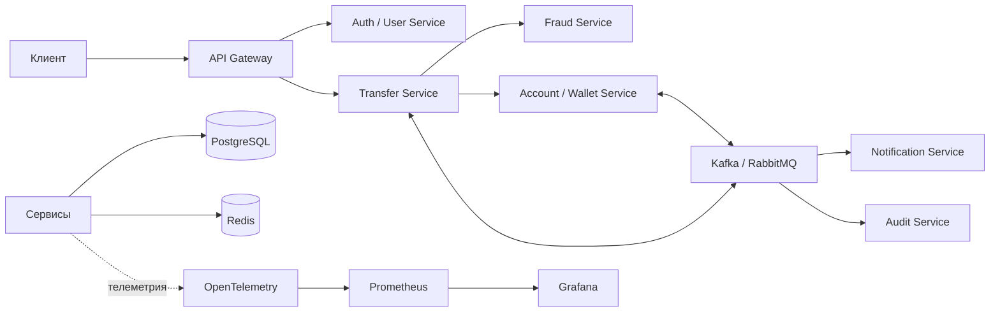

# Distributed Payment Processing System

Учебный проект распределённой платёжной системы, построенной на основе микросервисной архитектуры.

Цель проекта — самостоятельно спроектировать и реализовать систему, которая безопасно обрабатывает P2P-переводы между счетами пользователей, не допускает двойного списания, сохраняет согласованность данных при сбоях и остаётся наблюдаемой под высокой нагрузкой.

> **Текущий статус:** начата реализация Transfer Service. Созданы слои Domain, Application и Infrastructure; решение собирается, но запускаемого API и готового окружения пока нет.

## О проекте

В итоговом виде система должна состоять из нескольких независимых сервисов. Каждый сервис будет отвечать за отдельную предметную область, владеть своими данными и взаимодействовать с остальными сервисами через API и асинхронные события.

Основное внимание в проекте будет уделено не только обычному сценарию перевода, но и сложным ситуациям:

- повторной отправке одного запроса;
- повторной доставке события;
- временной недоступности базы данных или брокера сообщений;
- остановке одного из сервисов во время обработки перевода;
- компенсации уже выполненных действий;
- восстановлению обработки после сбоя без потери перевода.

## Статус разработки

На данный момент:

- [x] сформулирована идея проекта;
- [x] определены предполагаемые сервисы и их зоны ответственности;
- [x] составлен предварительный список инфраструктурных компонентов;
- [x] выбран базовый стек для Transfer Service;
- [x] создана доменная модель перевода и его жизненный цикл;
- [ ] описаны API-контракты и схемы событий;
- [x] создана структура решения и исходного кода Transfer Service;
- [x] реализованы базовые сценарии создания перевода и чтения по идентификатору;
- [x] добавлена персистентность Transfer Service через EF Core и PostgreSQL;
- [ ] создан запускаемый API-хост;
- [ ] реализованы остальные сервисы;
- [ ] подготовлено локальное окружение;
- [ ] добавлены автоматические тесты;
- [ ] настроены мониторинг и трассировка;
- [ ] подготовлено развёртывание в Kubernetes;
- [ ] проведено нагрузочное тестирование.

Список будет обновляться по мере развития проекта. Отмеченная задача означает, что соответствующий результат действительно реализован или зафиксирован в репозитории.

## Что реализовано

### Структура Transfer Service

Решение разделено на три проекта:

- `Transfer.Domain` — агрегат перевода, value objects, статусы и доменные правила;
- `Transfer.Application` — команды, запросы, DTO, валидация и контракты персистентности;
- `Transfer.Infrastructure` — EF Core, PostgreSQL, конфигурация модели, репозиторий и read-запросы.

Направление зависимостей: Application зависит от Domain, Infrastructure зависит от Application и Domain.

### Реализованные сценарии

- создание перевода через MediatR-команду `CreateTransferCommand`;
- валидация команд и запросов через FluentValidation;
- получение перевода по идентификатору через `GetTransferByIdQuery`;
- возврат результата через единый тип `Result<T>`;
- сохранение перевода через EF Core;
- защита от повторного создания перевода по паре `SenderAccountId + IdempotencyKey`;
- возврат существующего перевода при повторе запроса с теми же данными;
- конфликт при повторном использовании ключа идемпотентности с другими данными;
- optimistic concurrency через поле `Version`;
- доменные переходы между статусами `Created`, `Processing`, `FundsReserved`, `Succeeded`, `Failed`, `Rejected` и `Cancelled`.

### Пока не реализовано

- HTTP API и OpenAPI;
- миграции и готовая схема развёртывания PostgreSQL;
- Auth, Wallet, Fraud, Notification и Audit Service;
- брокер сообщений, Outbox / Inbox, Saga, retry и DLQ;
- Docker, Kubernetes и локальное окружение;
- автоматические тесты и наблюдаемость.

## Планируемый функционал

Ниже перечислены целевые возможности системы. Часть Transfer Service уже реализована и отдельно описана выше; остальные возможности пока являются планом.

### Auth / User Service

- регистрация и управление пользователями;
- аутентификация с помощью JWT;
- роли и разграничение доступа;
- авторизация запросов к API.

### Transfer Service

- создание P2P-перевода между счетами пользователей — реализовано на уровне Application и Infrastructure;
- получение состояния перевода по идентификатору — реализовано на уровне Application и Infrastructure;
- доменные операции подтверждения, отклонения, отмены и завершения перевода;
- координация списания со счёта отправителя и зачисления на счёт получателя;
- контроль допустимых переходов между статусами — реализован в доменной модели.

### Account / Wallet Service

- хранение балансов;
- резервирование средств;
- списание и зачисление средств;
- журнал движения денежных средств;
- защита от двойного списания.

### Fraud Service

- базовые антифрод-проверки до списания средств;
- проверка лимитов;
- выявление подозрительно частых операций;
- возможность расширения набора правил.

### Notification Service

- уведомления об успешном переводе;
- уведомления об ошибке или отмене;
- уведомления об отклонении перевода.

### Audit Service

- история критичных действий;
- фиксация изменений статусов;
- сохранение данных для анализа спорных операций;
- поиск событий по идентификаторам перевода, счетов и трассировки.

## Целевая архитектура



Диаграмма показывает целевую архитектуру. Сейчас в коде присутствует только основа Transfer Service без API-хоста и интеграций с другими сервисами.

## Планируемые механизмы надёжности

### Idempotency

Для создания перевода реализована идемпотентность в пределах отправителя. Уникальность пары `SenderAccountId + IdempotencyKey` обеспечивается ограничением PostgreSQL. Повтор с теми же данными возвращает существующий перевод, а повтор с изменёнными данными завершается конфликтом.

### Outbox / Inbox Pattern

Пока не реализовано. Изменение бизнес-данных и создание исходящего события должны фиксироваться атомарно. Получатели событий должны распознавать повторную доставку и не применять одно событие несколько раз.

### Saga

Пока не реализовано. Цепочка обработки перевода будет состоять из локальных транзакций. Если один из этапов завершится ошибкой, система должна выполнить компенсирующие действия для возврата в согласованное состояние.

### Retry и Dead Letter Queue

Пока не реализовано. Для временных ошибок будет использоваться повторная обработка с задержкой. Сообщения, которые невозможно обработать после заданного количества попыток, будут помещаться в Dead Letter Queue.

### Redis

Пока не подключён. Redis планируется использовать для кеширования, ограничения частоты запросов и распределённых блокировок там, где это действительно необходимо.

## Технологии

Для Transfer Service уже используются:

| Назначение | Технология |
| --- | --- |
| Платформа | .NET 10 / C# |
| Архитектура приложения | DDD, разделение Domain / Application / Infrastructure |
| Команды и запросы | MediatR 14.2.0 |
| Валидация | FluentValidation 12.2.0 |
| Доступ к данным | Entity Framework Core 10.0.12 |
| Провайдер базы данных | Npgsql 10.0.3 |
| Транзакционное хранилище | PostgreSQL |

Планируемые, но ещё не подключённые технологии:

| Назначение | Технология |
| --- | --- |
| Брокер сообщений | Kafka или RabbitMQ — не выбран |
| Кеш и rate limiting | Redis |
| Контейнеризация | Docker |
| Оркестрация | Kubernetes |
| Трассировка | OpenTelemetry |
| Метрики | Prometheus |
| Визуализация метрик | Grafana |

## Целевой сценарий P2P-перевода

1. Пользователь отправляет запрос на перевод средств со своего счёта на счёт другого пользователя с ключом идемпотентности.
2. API Gateway проверяет доступ и передаёт запрос в Transfer Service.
3. Transfer Service проверяет, что счета отправителя и получателя существуют, различаются и доступны для операции, после чего сохраняет перевод в начальном статусе.
4. Fraud Service выполняет антифрод-проверку.
5. Account / Wallet Service атомарно списывает средства со счёта отправителя и зачисляет их на счёт получателя либо выполняет эти действия как согласованную последовательность локальных транзакций.
6. Transfer Service фиксирует успешный результат.
7. Notification Service отправляет уведомления участникам перевода.
8. Audit Service сохраняет историю операции.
9. При ошибке Saga запускает необходимые компенсирующие действия, чтобы восстановить балансы и согласованное состояние перевода.

Сейчас реализованы создание и сохранение перевода, защита создания от повторов, чтение по идентификатору и доменные переходы статусов. Межсервисная координация, списание средств, события и компенсации пока отсутствуют.

## Запуск проекта

Требуется .NET 10 SDK.

Восстановление зависимостей и сборка решения:

```powershell
dotnet restore ".\Distributed Payment Processing System\Distributed Payment Processing System.slnx"
dotnet build ".\Distributed Payment Processing System\Distributed Payment Processing System.slnx"
```

На текущем этапе решение успешно собирается, но запустить приложение нельзя: API-хост, конфигурация подключения, миграции и контейнеры ещё не созданы.

После появления первой рабочей версии здесь будут опубликованы:

- пример файла переменных окружения;
- инструкция по первичной настройке;
- команды локального запуска;
- команды запуска через Docker Compose;
- способ применения миграций базы данных;
- адреса API, Swagger/OpenAPI и интерфейсов мониторинга;
- инструкция по остановке и очистке локального окружения.

В README не будут добавляться неподтверждённые команды запуска. Каждая опубликованная инструкция должна быть проверена на актуальной версии проекта.

## Конфигурация

Переменные окружения ещё не определены. Когда они появятся, репозиторий будет содержать безопасный пример конфигурации, например `.env.example`, без паролей, токенов и других секретов.

Предполагаемые группы настроек:

- подключения к PostgreSQL;
- подключения к Kafka или RabbitMQ;
- подключения к Redis;
- параметры JWT;
- тайм-ауты и retry-политики;
- адреса внутренних сервисов;
- настройки логирования, метрик и трассировки.

## API

HTTP API ещё не реализовано. Сейчас доступны только внутренние Application-команды и запросы. Внешние контракты планируется описывать с помощью OpenAPI и поддерживать вместе с кодом.

Для изменяющих состояние запросов предполагается поддержка заголовка идемпотентности, например:

```http
Idempotency-Key: <unique-operation-key>
```

Точные маршруты, форматы запросов, ответы и коды ошибок будут добавлены после проектирования контрактов.

## Тестирование

Тесты ещё не реализованы. В проекте планируются:

- **unit-тесты** — бизнес-правила и переходы статусов;
- **integration-тесты** — взаимодействие с PostgreSQL, Redis и брокером сообщений;
- **contract-тесты** — совместимость API и событий разных сервисов;
- **end-to-end-тесты** — полный путь перевода, его отклонения и компенсации;
- **load-тесты** — обработка тысяч одновременных переводов;
- **failure-тесты** — поведение системы при сбоях инфраструктуры и сервисов.

Отдельно будут проверяться следующие ситуации:

- брокер сообщений недоступен после сохранения перевода;
- одно событие доставлено несколько раз;
- ответ потерян после успешного списания;
- сервис остановлен во время выполнения Saga;
- база данных временно недоступна;
- сообщение исчерпало все попытки обработки и попало в DLQ.

## Наблюдаемость

Планируется добавить:

- health checks для сервисов и их зависимостей;
- структурированные логи;
- единый correlation ID / trace ID;
- распределённую трассировку через OpenTelemetry;
- метрики latency, количества ошибок и нагрузки;
- мониторинг очередей, повторных попыток и DLQ;
- дашборды в Grafana.

Чувствительные данные, токены и платёжные реквизиты не должны попадать в логи, события и трассировки.

## Развёртывание

Развёртывание ещё не настроено. В дальнейшем планируется использовать:

- Docker для сборки и локального запуска сервисов;
- Docker Compose для локального окружения;
- Kubernetes для оркестрации и масштабирования;
- readiness- и liveness-проверки;
- безопасное хранение конфигурации и секретов;
- независимые миграции данных для каждого сервиса.

## План разработки

1. Добавить API-хост и HTTP-контракты Transfer Service.
2. Создать миграции и локальное окружение PostgreSQL.
3. Покрыть доменную модель, Application и Infrastructure автоматическими тестами.
4. Реализовать Account / Wallet Service и интеграцию списания и зачисления.
5. Выбрать брокер сообщений и добавить Outbox / Inbox Pattern.
6. Реализовать Saga, retry-политику и Dead Letter Queue.
7. Добавить Auth, Fraud, Notification и Audit Service.
8. Подключить наблюдаемость и health checks.
9. Подготовить Docker- и Kubernetes-конфигурацию.
10. Провести нагрузочные испытания и тестирование отказов.

Порядок этапов может корректироваться по мере появления новых требований и результатов прототипирования.

## Использование искусственного интеллекта

Весь программный код проекта автор пишет самостоятельно вручную.

Искусственный интеллект используется только как вспомогательный инструмент при работе с документацией:

- автор самостоятельно определяет требования и содержание документов;
- автор даёт ИИ конкретные команды по структуре и оформлению текста;
- ИИ помогает форматировать документацию и улучшать её читаемость;
- автор обсуждает с ИИ возможные варианты оформления и принимает итоговые решения самостоятельно;
- автор проверяет и утверждает каждое изменение документации.

ИИ не является автором программной реализации и не заменяет самостоятельное проектирование и написание кода.

## Основные принципы

1. Принятый перевод не должен потеряться.
2. Повторный запрос не должен приводить к двойному списанию.
3. Каждое критичное изменение должно быть доступно для аудита.
4. Сбой отдельного компонента не должен нарушать целостность финансовых данных.
5. Состояние каждой операции должно быть наблюдаемым и объяснимым.
6. Документация должна описывать фактическое состояние проекта, а не выдавать планы за готовую реализацию.

## Лицензия

Лицензия пока не выбрана.
